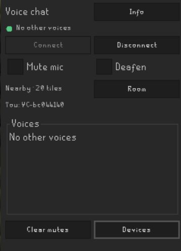

# OSRS Voice Chat

Talk to nearby players, your RuneLite party, or friends in a private voice room.

## Get talking

1. Enable **RS Voice Chat** and log in. Voice connects automatically.
2. Open the microphone sidebar tab. Green means connected, amber means connecting,
   and gray means disconnected.
3. Choose your microphone and speakers in **Devices**. Headphones are recommended.
4. Hold **Ctrl + V** to talk, or choose **Voice-activated** in settings.

Use **Disconnect** to stop voice and **Connect** to rejoin.

## Nearby voice

Talk to connected plugin users within **20 tiles**, on the **same world and floor**.
Nearby voice uses groups of up to **25** in the same map region. Busy regions
split into separate groups, so you may not hear everyone nearby.

The **Voices** list uses random aliases. Green bubbles show who's speaking.
When alone, your mic indicator can still react, but no audio is uploaded.

## Private rooms

Open **Room** to **Create** a room and share its code, or **Join** with a code.
Use **Share code** to copy it again and **Leave room** to return to nearby voice.

Rooms replace nearby voice and work across distances, worlds and floors while
you're logged in. Keep codes private: anyone with a valid code can join. Rooms
close when everyone leaves.
Private and party rooms hold **25 people**. **Room full** means try joining again
later; it does not retry automatically.
If reconnecting cannot restore your private room, voice pauses without changing
your mic setting. Choose **Retry room** or **Return to nearby** in the sidebar.

## Party voice

Join a party using **Party** or **Hub Party Panel**, then click **Join party voice**.
Each person needs RS Voice Chat connected and must click to join.

- Replaces nearby voice or your private room; works across worlds and distances.
- The button becomes **Leave party voice**. Leaving returns to nearby voice and
  keeps your mute setting.
- Leaving or switching parties also exits party voice. After logout, click
  **Join party voice** again.

## Stay in control

- **Mute mic / F8:** toggle your microphone mute.
- **Deafen / F9:** toggle incoming voice and mic mute. Undeafening preserves mic mute.
- **Voice volume:** adjust everyone, or use individual sliders and **Mute** buttons.
- **Clear mutes:** unmute other voices.
- Crossed-out mic/headphone icons show a peer's self-mute/deafen status, with a short delay.
- **Speaking indicators:** toggle speaking bubbles.

Hotkeys are configurable and require game focus. Voice activation works while
RuneLite is focused. Party/private voice continues through loading and world hops;
nearby voice waits for your new position. Temporary game connection loss preserves
your room. Logging out disconnects voice.

## Connection help

Check that everyone is connected and nearby,
in the same room, or has joined party voice. If you can't be heard, check **Devices**,
your voice mode, mute and deafen. Temporary network failures reconnect automatically.
**Voice server full** means all slots are occupied; the plugin retries automatically.

## Installation warning

> This plugin submits your IP address and live microphone audio to a 3rd-party server not controlled or verified by Runelite developers.

## License

BSD-2-Clause. Audio uses Concentus; its license and notices are included in
[third_party/concentus](third_party/concentus).
